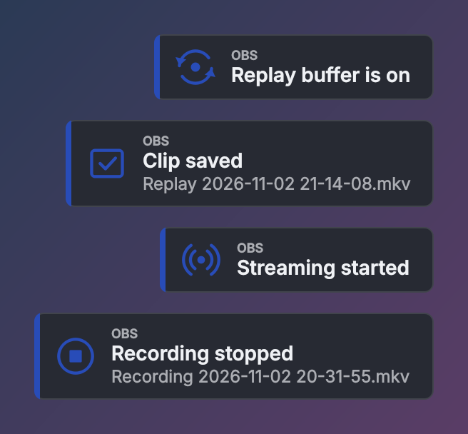
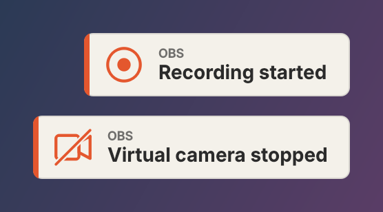
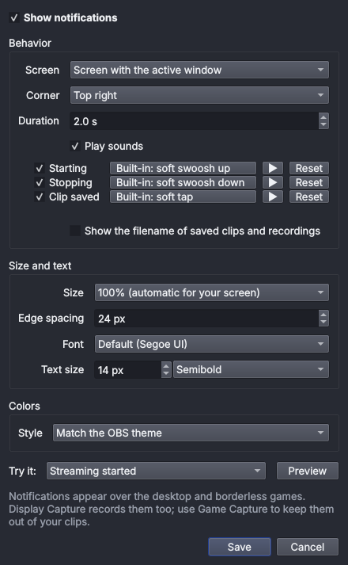

# OBS Notifier

Small, theme-aware desktop notifications for OBS Studio on Windows.

See at a glance when the replay buffer, streaming, recording, or virtual camera
starts or stops, and when a clip is saved, even while you're in a game.



## Features

- Compact notifications that scale automatically with your screen resolution.
- Matches your OBS theme, or use your own background, text, and accent colors.
- Choose the font, text size, and title weight.
- Optional soft sounds for starting, stopping, and saved clips. Turn each one
  on or off, or pick your own `.wav` file.
- Pick the screen, corner, duration, size, and edge spacing.
- Works with your existing OBS hotkeys, and tells you when something is
  already running or already stopped.

<p>
  
  
</p>

## Install

1. Download the latest release ZIP.
2. Close OBS.
3. Copy `obs-notifier.dll` into `obs-plugins\64bit` inside your OBS folder
   (usually `C:\Program Files\obs-studio`).
4. Start OBS and open **Tools → OBS Notifier…**.

To uninstall, close OBS and delete the DLL.

Notifications show over the desktop and borderless or windowed games. Exclusive
fullscreen games may cover them. Display Capture records them; Game Capture doesn't.

## Build

Requires Windows x64, OBS Studio 33, CMake 3.28+, and the Windows 10/11 SDK.

```powershell
./scripts/prepare-deps.ps1   # downloads OBS headers, Qt, and the MSVC toolset into .deps
./scripts/build.ps1          # writes the DLL and release ZIP to dist
```

The built-in sounds are generated by `scripts/generate-sounds.ps1`.

## License

GPL-2.0-or-later. See [LICENSE](LICENSE).
